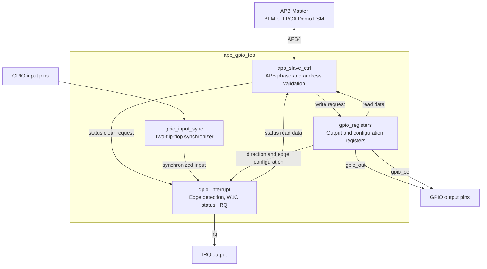
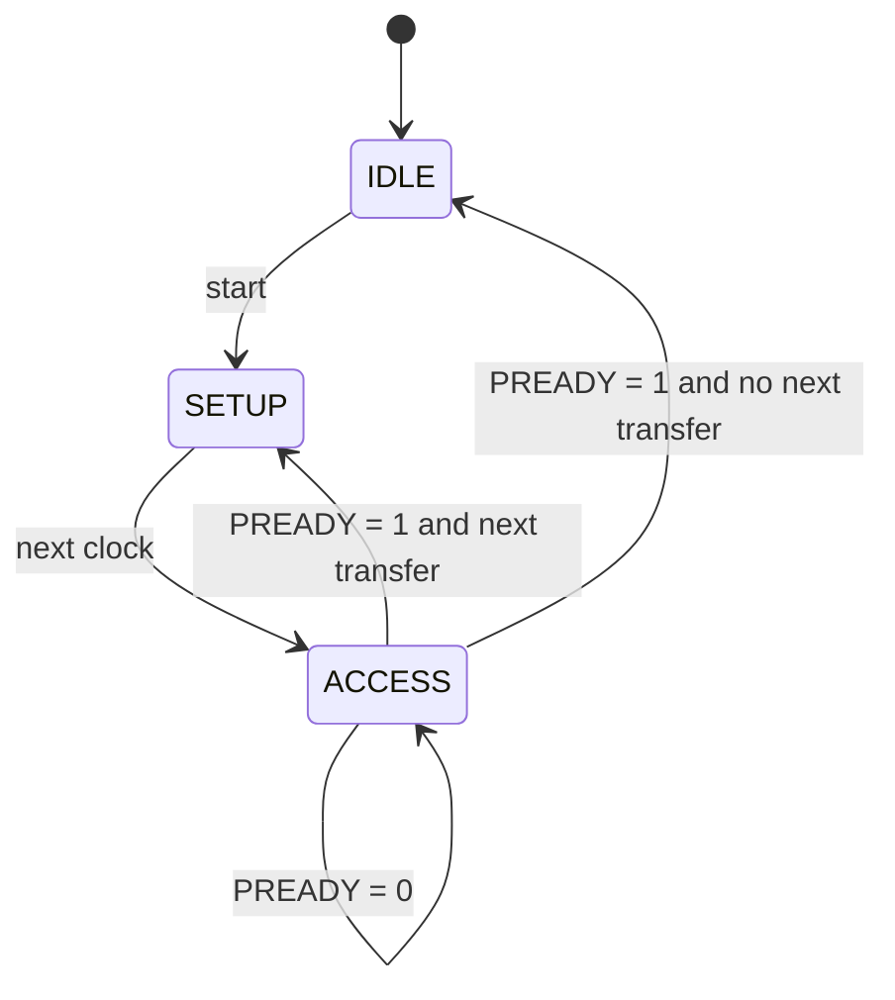
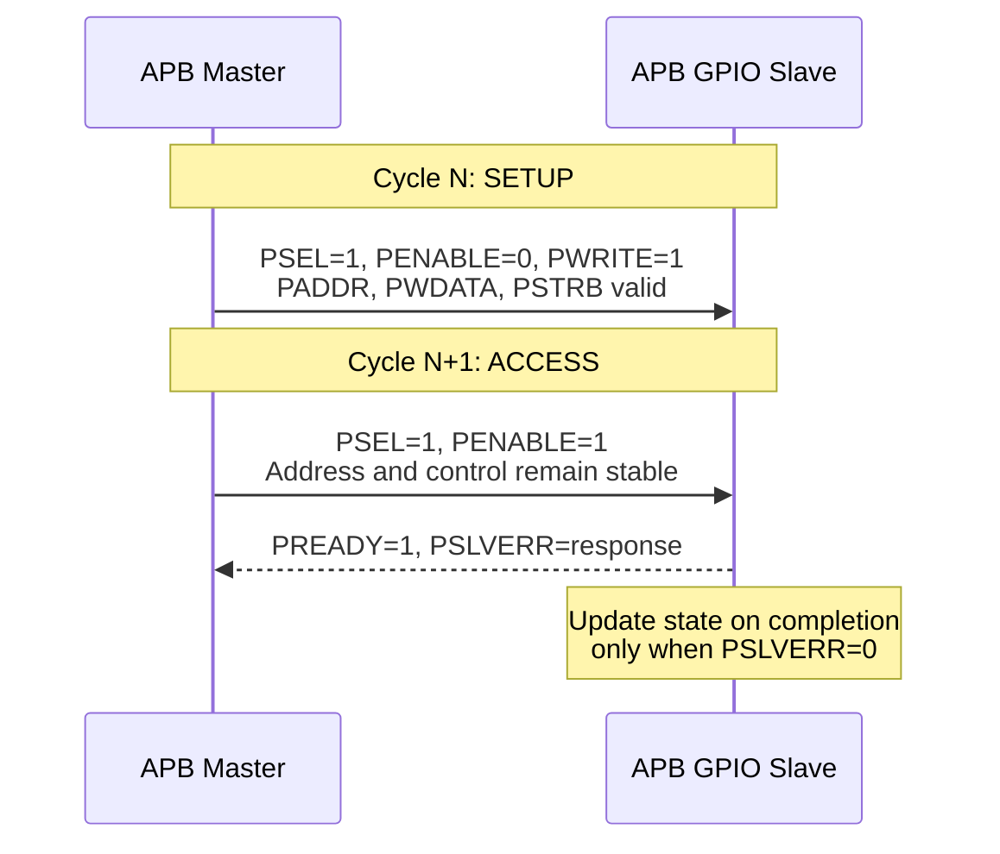
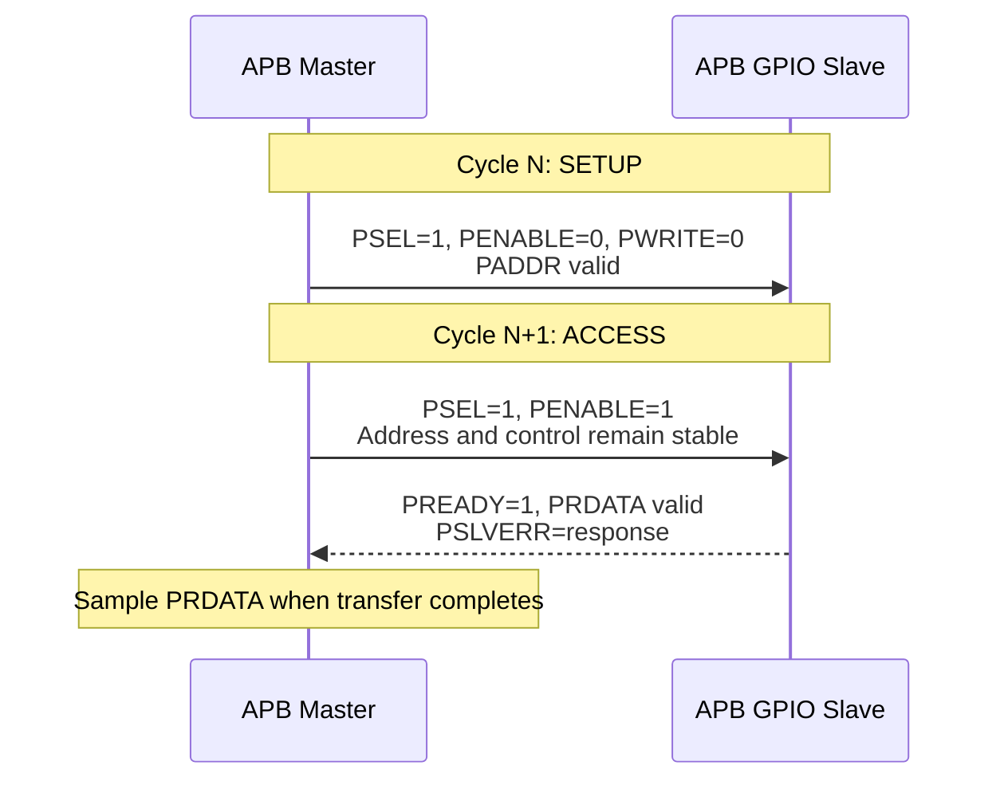

# T1 APB GPIO Design Proposal

## 1. Project Definition

This project implements a 32-bit GPIO controller as an APB4 slave for an Intel Cyclone V SoC FPGA target. The core provides software-controlled outputs, synchronized inputs, per-pin direction control, and configurable rising-edge and falling-edge interrupts.

The implementation target is synthesizable Verilog-2001. The testbench may use SystemVerilog. The APB slave uses zero wait states. Board-specific pin mapping and polarity handling are isolated in `fpga_top.v`.

### 1.1 Required Features

- 32-bit `DATA_OUT`, `DATA_IN`, `DIRECTION`, `INT_ENABLE`, and `INT_STATUS` registers.
- Per-pin rising-edge, falling-edge, or both-edge interrupt detection.
- Two-flip-flop synchronization for asynchronous GPIO inputs.
- Write-one-to-clear interrupt status.
- APB4 byte writes through `PSTRB`.
- `PSLVERR` for invalid, misaligned, or unsupported register accesses.
- Self-checking simulation and an FPGA demonstration.

### 1.2 Phase 1 Design Decisions

| Item | Decision |
|---|---|
| RTL language | Verilog-2001 |
| Testbench language | SystemVerilog |
| GPIO width | 32 bits |
| APB data width | 32 bits |
| APB address width | 8 bits |
| APB response | Zero wait state |
| Reset | Asynchronous active-low `PRESETn` |
| Output direction encoding | `0` = input, `1` = output |
| Interrupt capture | Only pins configured as inputs |
| Interrupt mask behavior | `INT_ENABLE` masks `irq`, not status capture |
| Simultaneous event and clear | A new event has priority over W1C clear |
| Read-only register write | Complete transfer with `PSLVERR = 1`; no state change |
| Invalid or misaligned access | Complete transfer with `PSLVERR = 1`; no state change |
| `PPROT` | Accepted but not used for access control |
| Zero `PSTRB` write | Valid no-operation without `PSLVERR` |
| Stretch features | Excluded unless all required work is complete |
| FPGA target | Intel Cyclone V SoC FPGA |
| FPGA toolchain | Intel Quartus Prime |
| Constraints | Quartus `.qsf` pin assignments and `.sdc` timing constraints |
| On-chip debug | SignalTap Logic Analyzer |
| Programming output | Quartus `.sof` file |

## 2. Architecture



### 2.1 Module Responsibilities

| Module | Responsibility |
|---|---|
| `apb_gpio_top.v` | Integrate the APB, register, synchronizer, and interrupt blocks. |
| `apb_slave_ctrl.v` | Detect completed APB transfers, validate accesses, multiplex read data, and generate `PREADY` and `PSLVERR`. |
| `gpio_registers.v` | Store `DATA_OUT`, `DIRECTION`, `INT_ENABLE`, `INT_RISE_ENABLE`, and `INT_FALL_ENABLE`; apply `PSTRB`. |
| `gpio_input_sync.v` | Synchronize each asynchronous GPIO input through two flip-flops. |
| `gpio_interrupt.v` | Detect configured edges, store W1C pending bits, and generate `irq`. |
| `apb_master_demo.v` | Generate a fixed sequence of APB accesses for the FPGA demonstration. |
| `reset_sync.v` | Assert reset asynchronously and release it synchronously. |
| `button_debounce.v` | Synchronize and debounce the demonstration button input. |
| `fpga_top.v` | Integrate the demo master, reset/debounce logic, and APB GPIO core behind a board-independent interface. |
| `de10_standard_top.v` | Map the generic FPGA demo to DE10-Standard clock, keys, switches, and red LEDs. |

## 3. External Interfaces

### 3.1 APB GPIO Core

Proposed top-level declaration:

```verilog
module apb_gpio_top #(
    parameter integer GPIO_WIDTH = 32,
    parameter integer APB_ADDR_WIDTH = 8,
    parameter integer APB_DATA_WIDTH = 32
) (
    input  wire                      PCLK,
    input  wire                      PRESETn,
    input  wire [APB_ADDR_WIDTH-1:0] PADDR,
    input  wire                      PSEL,
    input  wire                      PENABLE,
    input  wire                      PWRITE,
    input  wire [APB_DATA_WIDTH-1:0] PWDATA,
    input  wire [APB_DATA_WIDTH/8-1:0] PSTRB,
    input  wire [2:0]                PPROT,
    output wire [APB_DATA_WIDTH-1:0] PRDATA,
    output wire                      PREADY,
    output wire                      PSLVERR,

    input  wire [GPIO_WIDTH-1:0]     gpio_in_async,
    output wire [GPIO_WIDTH-1:0]     gpio_out,
    output wire [GPIO_WIDTH-1:0]     gpio_oe,
    output wire                      irq
);
```

The IP core does not use bidirectional `inout` ports. `fpga_top.v` combines `gpio_out`, `gpio_oe`, and the physical pins. This keeps tri-state buffers at the FPGA boundary and simplifies simulation.

### 3.2 Internal Write Interface

`apb_slave_ctrl` generates a one-cycle write request only when an APB write completes:

```verilog
write_fire = PSEL && PENABLE && PREADY && PWRITE && !PSLVERR;
```

The internal request contains:

| Signal | Width | Meaning |
|---|---:|---|
| `write_fire` | 1 | Valid mapped write completed. |
| `write_addr` | 8 | Register byte offset. |
| `write_data` | 32 | APB write data. |
| `write_strb` | 4 | Per-byte write enable. |

Read data is combinationally selected from synchronized inputs and stored register values. Register state changes only on the rising edge of `PCLK`.

## 4. Register Map

All registers are 32 bits wide and word aligned.

| Offset | Register | Access | Reset | Description |
|---:|---|---|---:|---|
| `0x00` | `DATA_OUT` | RW | `0x00000000` | Output value for each GPIO pin. |
| `0x04` | `DATA_IN` | RO | See note | Synchronized GPIO input value. |
| `0x08` | `DIRECTION` | RW | `0x00000000` | `0` = input, `1` = output. |
| `0x0C` | `INT_ENABLE` | RW | `0x00000000` | Enables each pending bit in the combined `irq`. |
| `0x10` | `INT_STATUS` | RO/W1C | `0x00000000` | Pending interrupt status; write `1` to clear. |
| `0x14` | `INT_RISE_ENABLE` | RW | `0x00000000` | Enables rising-edge detection per input pin. |
| `0x18` | `INT_FALL_ENABLE` | RW | `0x00000000` | Enables falling-edge detection per input pin. |

`DATA_IN` reads the output of the two-flip-flop synchronizer. Both synchronizer stages reset to zero. After reset is released, `DATA_IN` reflects the physical input after the synchronization latency.

### 4.1 Byte Strobe Behavior

For normal RW registers, each asserted `PSTRB[n]` updates data bits `[8n+7:8n]`. Unstrobed bytes retain their previous values.

For `INT_STATUS`, the clear mask is:

```verilog
clear_mask = PWDATA & {
    {8{PSTRB[3]}},
    {8{PSTRB[2]}},
    {8{PSTRB[1]}},
    {8{PSTRB[0]}}
};
```

Writing zero retains the corresponding pending bit. Writing one clears it unless a new eligible event occurs in the same cycle.

## 5. Interrupt Behavior

Edge detection uses consecutive synchronized samples:

```verilog
rise_event =  current_input & ~previous_input;
fall_event = ~current_input &  previous_input;

eligible_event = ~direction &
                 ((rise_event & int_rise_enable) |
                  (fall_event & int_fall_enable));

int_status_next = (int_status & ~clear_mask) | eligible_event;
irq = |(int_status & int_enable);
```

The OR operation with `eligible_event` gives a new event priority over a simultaneous clear. Configuration writes take effect after the active clock edge; edge qualification during that edge uses the configuration stored before the edge.

`INT_ENABLE` does not prevent status capture. It only controls whether an already-pending status bit contributes to `irq`. This allows software to inspect events that occurred while the combined interrupt output was masked.

## 6. APB4 Slave Behavior

### 6.1 Transfer Rules

- SETUP phase: `PSEL = 1`, `PENABLE = 0`.
- ACCESS phase: `PSEL = 1`, `PENABLE = 1`.
- `PREADY` is always high, so each ACCESS phase completes in one cycle.
- `PRDATA` is valid during a mapped read ACCESS phase.
- `PSLVERR` is valid only during the final ACCESS cycle.
- Address, direction, write data, strobes, and protection attributes remain stable from SETUP through ACCESS.
- Back-to-back transfers move from ACCESS directly to the next SETUP phase.

### 6.2 Error Policy

| Access | Result |
|---|---|
| Read mapped register | Return register value, no error. |
| Write RW register | Update strobed bytes, no error. |
| Write `INT_STATUS` | Clear strobed bits written as one, no error. |
| Write `DATA_IN` | No state change, assert `PSLVERR`. |
| Access an unmapped address | Assert `PSLVERR`. |
| Access a non-word-aligned address | Assert `PSLVERR`. |

### 6.3 Demo Master FSM



| State | `PSEL` | `PENABLE` | Required behavior |
|---|---:|---:|---|
| `IDLE` | 0 | 0 | Wait for a request. |
| `SETUP` | 1 | 0 | Drive and hold address, direction, data, and strobes. |
| `ACCESS` | 1 | 1 | Hold control signals until `PREADY` is high; sample response. |

### 6.4 Write Timing



### 6.5 Read Timing



## 7. Verification Plan

### 7.1 Directed Tests

- Reset values for every stored register and interrupt output.
- Read and write every mapped register.
- Confirm that writes to `DATA_IN` report an error without changing state.
- Test `PSTRB` values `0000`, `0001`, `0010`, `0100`, `1000`, and `1111`.
- Test invalid and misaligned addresses.
- Test normal and back-to-back APB transfers.
- Test rising-edge, falling-edge, and both-edge modes.
- Confirm that output pins do not generate interrupts.
- Confirm that `INT_ENABLE` masks `irq` without preventing status capture.
- Confirm W1C behavior and new-event priority over simultaneous clear.
- Check the two-cycle input synchronization behavior.

### 7.2 Self-Checking Infrastructure

- APB BFM tasks for read and write transfers.
- Reference model for all stored registers and pending interrupt bits.
- Scoreboard comparison after every relevant transfer or GPIO event.
- Assertions for APB phase ordering and signal stability.
- Functional coverage for registers, strobes, errors, edge modes, masking, and clear/event collisions.

## 8. Cyclone V SoC FPGA Demonstration Plan

The Cyclone V board wrapper maps only the available physical pins while the core remains 32 bits wide. The project is built with Intel Quartus Prime and uses `.qsf` pin assignments plus `.sdc` timing constraints.

1. Reset the design and show that outputs and `irq` are inactive.
2. Write `DIRECTION` to configure LED-connected pins as outputs.
3. Write multiple patterns to `DATA_OUT` and observe the LEDs.
4. Read switch-connected pins through `DATA_IN`.
5. Enable a rising-edge interrupt for a debounced button.
6. Press the button and observe the IRQ LED.
7. Write one to the matching `INT_STATUS` bit and observe the IRQ LED turn off.
8. Capture at least one APB transfer with SignalTap Logic Analyzer.

## 9. Proposed Source Tree

```text
T1_APB_GPIO/
|-- rtl/
|   |-- apb_gpio_top.v
|   |-- apb_slave_ctrl.v
|   |-- gpio_registers.v
|   |-- gpio_input_sync.v
|   |-- gpio_interrupt.v
|   |-- reset_sync.v
|   |-- button_debounce.v
|   |-- apb_master_demo.v
|   `-- fpga_top.v
|-- tb/
|   |-- tb_apb_slave_ctrl.sv
|   |-- tb_gpio_registers.sv
|   |-- tb_gpio_input_sync.sv
|   |-- tb_gpio_interrupt.sv
|   |-- tb_apb_registers.sv
|   |-- tb_apb_gpio_top.sv
|   |-- tb_reset_sync.sv
|   |-- tb_button_debounce.sv
|   |-- tb_apb_master_demo.sv
|   |-- tb_fpga_top.sv
|   |-- apb_bfm.sv
|   |-- gpio_scoreboard.sv
|   `-- apb_assertions.sv
|-- constraints/
|   |-- cyclone_v_gpio.qsf
|   `-- cyclone_v_gpio.sdc
|-- reports/
`-- docs/
```

## 10. Phase 1 Completion and Open Items

The architecture, register map, APB behavior, module boundaries, interrupt policy, verification strategy, and demo flow are frozen for Phase 2 implementation.

The target is the Terasic DE10-Standard Development and Education Kit with an Intel
Cyclone V SoC `5CSXFC6D6F31C6N`. The board information below is taken from
`docs/DE10-Standard_User_manual.pdf`:

- `CLOCK_50` is a 50 MHz, 3.3 V clock input on FPGA pin `AF14`.
- `KEY[0]` through `KEY[3]` are debounced, active-low push-buttons on pins `AJ4`,
  `AK4`, `AA14`, and `AA15`, respectively.
- `SW[0]` through `SW[9]` are level-sensitive inputs on pins `AB30`, `Y27`, `AB28`,
  `AC30`, `W25`, `V25`, `AC28`, `AD30`, `AC29`, and `AA30`, respectively. Their
  I/O voltage depends on jumper `JP3`.
- `LEDR[0]` through `LEDR[9]` are active-high, 3.3 V outputs on pins `AA24`, `AB23`,
  `AC23`, `AD24`, `AG25`, `AF25`, `AE24`, `AF24`, `AB22`, and `AC22`, respectively.

The board revision, the Quartus Prime version compatible with the installed
environment, and the final JTAG programming procedure remain open. These items must
be confirmed before hardware programming; they do not affect the APB GPIO core.

These items affect only `fpga_top.v`, constraints, and the demonstration project. They do not change the APB GPIO core interface or register map.

## 11. Seven-Phase Milestones

| Phase | Exit criterion |
|---:|---|
| 1 | Architecture, interfaces, register map, timing, and this proposal are complete. |
| 2 | Core RTL integrates and basic unit tests pass. |
| 3 | All required features pass directed tests. |
| 4 | BFM, scoreboard, random tests, assertions, and coverage are complete. |
| 5 | FPGA demo works and timing/utilization reports are available. |
| 6 | SignalTap capture, report, slides, and D1-D6 package are complete. |
| 7 | Final regression, bug fixes, demo rehearsal, and Q&A rehearsal are complete. |
