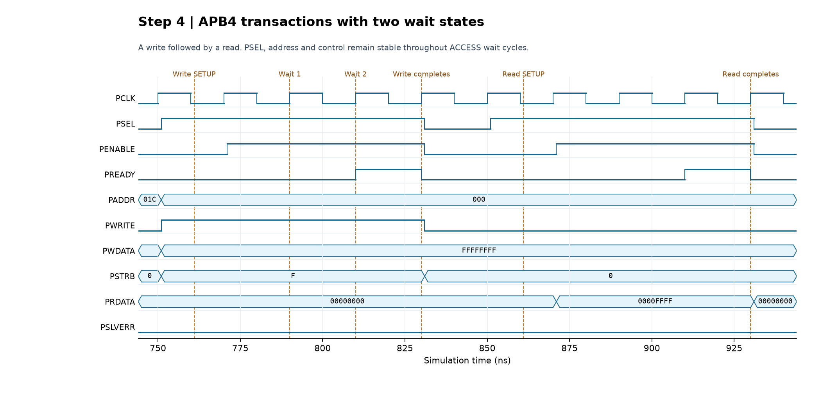
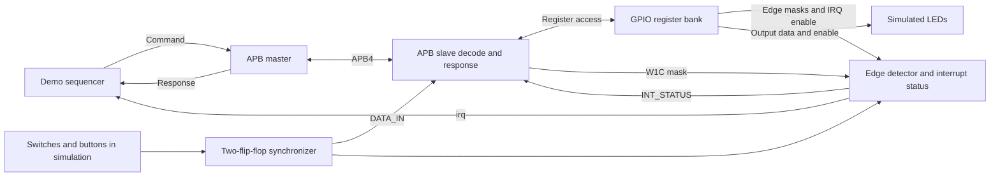
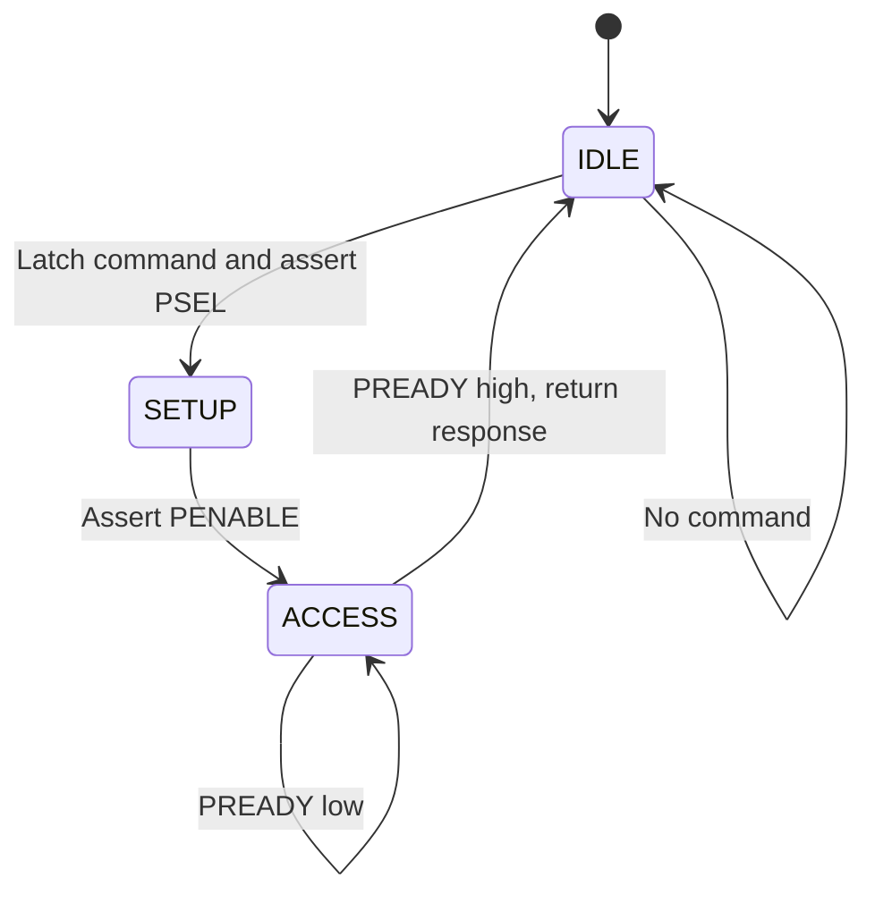
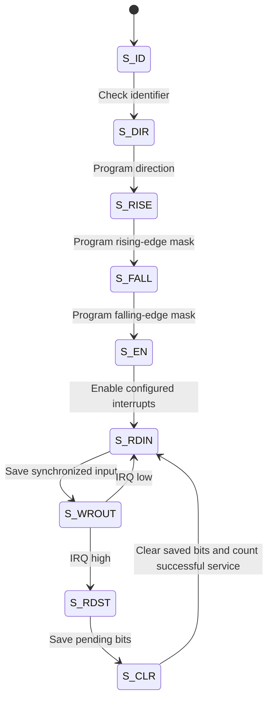

# Design and Verification of an APB4 GPIO Peripheral with Edge-Triggered Interrupts

**Digital System Design Midterm Project · Topic 1 · D5 Technical Report**

| Field | Details |
| --- | --- |
| Course and section | [Insert course code and section] |
| Instructor | [Insert instructor name] |
| Team members | [Insert both names and student IDs] |
| Submission date | [Insert date] |
| RTL commit | `5b376be` for the hardware and tutorial RTL. The FPGA project is `Mid_dsd`. |
| FPGA target | Terasic DE10-Standard |

## Abstract

This project implements a GPIO peripheral with an AMBA APB4 slave interface, a 32-bit register bank, configurable edge interrupts and write-one-to-clear interrupt status. The GPIO width is configurable from 1 to 32 pins. A demonstration sequencer uses an APB master to transfer switch values to LEDs and service pending interrupts. Six simulation stages passed in Icarus Verilog, including directed register tests, a system demonstration and 15 constrained-random runs across five seeds and three wait-state settings. The random scoreboard reported zero mismatches in those 15 runs and detected 14 mismatches when the interrupt clear priority was deliberately reversed. System-level simulation used 16 GPIO pins. A Questa run passed the APB assertions and detected an injected request-stability violation. A separate 32-pin directed test passed. The Quartus project, `Mid_dsd`, builds the separate DE10-Standard demonstration and provides its fitter, TimeQuest and programming artifacts.

## 1. Introduction and Requirements

Topic 1 requires a GPIO peripheral with a documented 32-bit register interface. Software reads synchronized GPIO inputs, writes output values, configures per-pin direction and selects which rising or falling edges generate interrupt events. Software reads pending status and clears selected bits with a write-one-to-clear (W1C) operation. The APB slave supports byte strobes and responds with `PSLVERR` to unmapped accesses.

The project includes a tutorial system for protocol verification and a DE10-Standard implementation for the FPGA demo. In the tutorial system, the APB master reads switch inputs, writes them to the output register and services interrupts. Section 6 describes the register map and behavior of the FPGA implementation.

| Topic 1 requirement | RTL implementation | Simulation evidence |
| --- | --- | --- |
| Input, output and direction registers | `apb_gpio` and `byte_reg` | Step 4 reset and register checks |
| Two-flip-flop GPIO input synchronization | `sync_2ff` | Steps 1 and 4 |
| Rising, falling and both-edge interrupts | `edge_detect` and `gpio_irq` | Steps 3, 4 and 6 |
| Sticky status with W1C | `gpio_irq` and the slave clear mask | Steps 3–5 |
| Byte-lane writes | `byte_reg` and `PSTRB` | Steps 2, 4 and 5 |
| Error response for illegal accesses | Address decoder in `apb_gpio` | Steps 4 and 5 |
| Switches, LEDs and interrupt service through APB | `gpio_system` | Step 6 system simulation and FPGA demo results in Section 6. |

## 2. APB4 Protocol

APB transfers use a one-cycle SETUP phase followed by one or more ACCESS cycles. At SETUP the master asserts `PSEL` and drives the address and control signals with `PENABLE` low. It asserts `PENABLE` in ACCESS and holds the request stable until the rising clock edge at which `PSEL`, `PENABLE` and `PREADY` are all high. On that edge the master samples the read data or error response. A legal write updates the addressed register at the same completion edge.

| Signal | Width in this design | Role |
| --- | ---: | --- |
| `PCLK`, `PRESETn` | 1 each | APB clock and active-low reset |
| `PSEL`, `PENABLE` | 1 each | Slave selection and ACCESS indication |
| `PADDR` | 12 | Byte address within the peripheral |
| `PWRITE` | 1 | High for write and low for read |
| `PWDATA`, `PRDATA` | 32 each | Write and read data respectively |
| `PSTRB` | 4 | One strobe per write byte, all zero during reads |
| `PPROT` | 3 | Protection attributes accepted at the slave interface |
| `PREADY` | 1 | Slave transfer completion |
| `PSLVERR` | 1 | Error status in the completing ACCESS cycle |

For two wait states, the slave keeps `PREADY` low in the first two ACCESS cycles and asserts it in the third. The table describes the expected sequence while the selected transfer is in progress.

| Phase | `PSEL` | `PENABLE` | `PREADY` | Effect |
| --- | ---: | ---: | ---: | --- |
| SETUP | 1 | 0 | — | Address and request signals are driven. |
| ACCESS, first wait | 1 | 1 | 0 | The master holds the request. |
| ACCESS, second wait | 1 | 1 | 0 | The master continues holding the request. |
| ACCESS, completion | 1 | 1 | 1 | A legal write commits, or read data and error status are sampled. |



*Figure 1. APB4 write and read through two wait states, captured from the Step 4 Questa simulation.*

## 3. Architecture and Register Map

### 3.1 System architecture



The `apb_gpio` slave decodes aligned addresses from `0x00` to `0x1C`. It generates a write enable only for legal writes in the completing ACCESS cycle. Unmapped and unaligned accesses return an error. Writes to the read-only `DATA_IN` and `ID` registers also return an error. Reads of unmapped or unaligned addresses return zero. `PPROT` is present on the interface and does not affect register access.

The bus and register data width is 32 bits. Parameter `N` selects the number of GPIO pins, with a default of 16 and a supported range of 1–32. Unimplemented GPIO bits read as zero. `WAIT_STATES` selects 0–15 additional ACCESS cycles. `ID` supplies the read-only peripheral identifier.

### 3.2 Register map

The table applies to `midterm_project/rtl/apb_gpio.v`, the peripheral used by the tutorial regression. Reset values are hexadecimal. For pin-dependent registers, bit `i` corresponds to GPIO pin `i`.

| Offset | Register | Access | Reset | Bit fields |
| --- | --- | --- | --- | --- |
| `0x00` | `DATA_OUT` | RW | `0x00000000` | `[N-1:0]` output values |
| `0x04` | `DATA_IN` | RO | `0x00000000` | `[N-1:0]` synchronized inputs, updated as pins are sampled after reset |
| `0x08` | `DIR` | RW | `0x00000000` | `[N-1:0]` output enables, 0 for input and 1 for output |
| `0x0C` | `INT_ENABLE` | RW | `0x00000000` | `[N-1:0]` bits eligible to assert `irq` |
| `0x10` | `INT_RISE` | RW | `0x00000000` | `[N-1:0]` rising-edge detection enables |
| `0x14` | `INT_FALL` | RW | `0x00000000` | `[N-1:0]` falling-edge detection enables |
| `0x18` | `INT_STATUS` | RW1C | `0x00000000` | `[N-1:0]` pending events. Writing 1 clears the corresponding bit when its byte lane is enabled. |
| `0x1C` | `ID` | RO | `0x47504901` by default | `[31:0]` read-only peripheral identifier |

Both edge-enable bits can be set for one pin. For a partial write, `PSTRB[i]` enables byte `i` and the other bytes retain their previous values. Writes with all strobes low leave the registers unchanged.

### 3.3 APB master and demo sequencer



The master latches the request in IDLE, drives one SETUP cycle and waits in ACCESS until `PREADY` is high. It then returns the response data and error flag through a one-cycle `rsp_valid` pulse. The sequencer issues one outstanding command. Each transition below follows reception of the response for the current state.



## 4. Design Decisions and Problems Encountered

### 4.1 Asynchronous input sampling

External input transitions can occur at any point in the APB clock cycle. Two flip-flops sample each input before the signal enters the register and interrupt logic. The first stage can become metastable. The second stage gives the first a clock period to settle and reduces the chance that metastability propagates. The edge detector compares the synchronized value with its value on the previous cycle. A pulse shorter than a clock period can be missed if no sampling edge observes it. Mechanical bounce can generate several transitions over successive clock cycles, so debouncing is a separate function. Step 1 exercises both synchronization and a standalone debounce case.

### 4.2 Interrupt state and W1C priority

Pending state and interrupt reporting are separate. Configured edges set sticky status bits, and the interrupt output is the reduction OR of `INT_STATUS & INT_ENABLE`. This allows software to inspect a pending event while its contribution to `irq` is masked. The write data is first gated by the enabled byte lanes to form the W1C mask.

```text
next_status = (current_status AND NOT clear_mask) OR new_events
irq         = OR_REDUCE(current_status AND interrupt_enable)
```

This update preserves a new event when software clears the same bit in the same cycle. Servicing software writes back the bits returned by its status read, which limits the clear request to the events it observed. A sticky bit records that at least one event occurred, so several events on one already-pending pin can coalesce.

### 4.3 Verification bug hunt

The fault-injection experiment applied the clear mask after adding new events in `gpio_irq.v`. For wait state 0 and seed 1, the scoreboard recorded 14 incorrect reads of `INT_STATUS`. The first mismatch showed `0x00002596` with `0x00002796` expected. The set-over-clear implementation reported zero mismatches with the same test settings.

## 5. Verification Methodology and Results

### 5.1 Test environment

The regression uses **Icarus Verilog 12.0 (devel)**. APB BFM tasks drive read and write requests, manage the ACCESS wait and sample the response. Directed tests compare responses against known expected values. The random test uses a reference model for register writes, synchronizer stages, edge detection and interrupt status. It checks every completed read and error response and reports coverage for mapped reads and writes, byte strobe combinations, errors, IRQ activity and wait cycles. The additional overlap counter records W1C transactions that coincide with a new event on the same bit.

Reproduce the simulation from the repository root with Icarus Verilog on PATH.

```bash
bash midterm_project/sim/run_all.sh
```

### 5.2 Unit, directed and system results

| Step | Checks | Observed result |
| --- | --- | --- |
| 1 | Reset release, synchronization, edge detection and debounce | PASS. Reset released after two clocks. Detected all 101 rising and 99 falling events. Debounce reduced 21 simulated bounces to two clean changes. |
| 2 | Register reset, byte lanes, masked bits and zero strobe | PASS. The test checked 500 random byte writes in addition to directed cases. |
| 3 | Edge selection, masked pending event, W1C and priority | PASS. The test compared 2,000 random cycles with its model. |
| 4 | Reset, register read/write, illegal accesses and IRQ service | PASS. Both wait-state settings, 0 and 2, completed 51 transfers each with zero errors reported by the checks. |
| 5 | Random APB/GPIO stimulus, scoreboard and coverage | PASS. All 15 seed/wait-state combinations reported zero mismatches and zero coverage holes. |
| 6 | End-to-end APB demo and edge-specific interrupts | PASS. Switch value `0x0A50` appeared on the simulated LEDs. The interrupt count reached 4 across the configured button and pin transitions. |

### 5.3 Constrained-random coverage

Each row represents 4,000 generated APB transfers and a passing test. Error columns count expected APB error responses exercised by the stimulus. Coverage holes and mismatches count test failures or missed coverage requirements.

| Wait states | Seed | Error reads | Error writes | Wait cycles | W1C/event overlaps | Coverage holes | Mismatches |
| ---: | ---: | ---: | ---: | ---: | ---: | ---: | ---: |
| 0 | 1 | 309 | 767 | 0 | 14 | 0 | 0 |
| 0 | 7 | 320 | 745 | 0 | 9 | 0 | 0 |
| 0 | 12 | 311 | 697 | 0 | 20 | 0 | 0 |
| 0 | 42 | 356 | 665 | 0 | 12 | 0 | 0 |
| 0 | 2026 | 326 | 701 | 0 | 12 | 0 | 0 |
| 1 | 1 | 316 | 709 | 4000 | 12 | 0 | 0 |
| 1 | 7 | 346 | 767 | 4000 | 8 | 0 | 0 |
| 1 | 12 | 276 | 674 | 4000 | 13 | 0 | 0 |
| 1 | 42 | 301 | 732 | 4000 | 8 | 0 | 0 |
| 1 | 2026 | 310 | 719 | 4000 | 16 | 0 | 0 |
| 2 | 1 | 307 | 694 | 8000 | 23 | 0 | 0 |
| 2 | 7 | 326 | 690 | 8000 | 14 | 0 | 0 |
| 2 | 12 | 297 | 712 | 8000 | 13 | 0 | 0 |
| 2 | 42 | 301 | 706 | 8000 | 18 | 0 | 0 |
| 2 | 2026 | 318 | 717 | 8000 | 19 | 0 | 0 |

The [Questa Step 5 log](evidence/step5.log) shows per-register counts and all 16 byte-strobe bins for two wait states and seed 1. Questa and Icarus use different random streams.

### 5.4 Protocol assertions and scope

Questa Altera Starter FPGA Edition 2025.2 ran Step 5 with `WS=2`, seed 1 and assertions enabled. The normal run passed 4,000 transfers. With `BFM_BUG` enabled, assertion `a_stable` reported `APB R3: signals changed during a wait state` at **150 ns**, starting from the sample at 130 ns. See the [normal run](evidence/sva-normal.log) and the [first assertion failure](evidence/sva-negative.log).

Steps 4–6 use a 16-pin GPIO instance. A separate directed Step 4 test instantiated the tutorial peripheral at `N=32` and `WS=2`. It verified independent writes to byte lanes 2 and 3, synchronized input on GPIO31, IRQ assertion, and byte-qualified W1C. Writing the GPIO31 mask with lane 2 enabled left the interrupt pending. Writing it with lane 3 enabled cleared the status and deasserted IRQ. See the [testbench](../tb/tb_apb_gpio_n32.sv), [run log](evidence/n32-directed.log), and [GPIO31 waveform](evidence/n32-directed-waveform.png).

### 5.5 Waveform evidence

The annotated waveforms were rendered from Questa VCD captures. All six steps passed. Steps 4 and 5 used two wait states.

| Step | Waveform and observation | Run log |
| --- | --- | --- |
| 1 | [Reset release and the two-stage input synchronizer](evidence/step1-waveform.png) | [Step 1](evidence/step1.log) |
| 2 | [Byte 0 and byte 1 writes preserve the neighboring byte](evidence/step2-waveform.png) | [Step 2](evidence/step2.log) |
| 3 | [A new GPIO event wins when it coincides with W1C](evidence/step3-waveform.png) | [Step 3](evidence/step3.log) |
| 4 | [Figure 1 shows APB SETUP, waits and transfer completion](evidence/step4-waveform.png) | [Step 4](evidence/step4.log) |
| 5 | [A legal transfer and an error response with two wait states](evidence/step5-waveform.png) | [Step 5](evidence/step5.log) |
| 6 | [IRQ assertion, `INT_STATUS` read and W1C at `0x18`, and service count increment](evidence/step6-waveform.png) | [Step 6](evidence/step6.log) |

## 6. FPGA Implementation and Hardware Results

### 6.1 Quartus project and hardware architecture

Open [`Mid_dsd.qpf`](../../Mid_dsd.qpf). The [`Mid_dsd.qsf`](../../Mid_dsd.qsf) selects `de10_standard_top`, the Cyclone V `5CSXFC6D6F31C6` and ten Verilog source files in `midterm_project/rtl`. Its RTL and SDC match the files at commit `5b376be`. The QSF references these files through `../T1_APB_GPIO_project/`, which resolves from the current repository directory. A checkout with a different directory name needs those source and SDC references adjusted.

`de10_standard_top` maps the DE10-Standard connectors into `fpga_top`. The latter connects `reset_sync` and `button_debounce` to the fixed transaction sequencer `apb_master_demo` and the 32-bit `apb_gpio_top`. The peripheral contains `apb_slave_ctrl`, `gpio_registers`, `gpio_input_sync` and `gpio_interrupt`. The slave ties `PREADY` high for zero wait states. The interrupt block detects eligible edges on input-configured pins, retains a new event that coincides with a clear, and gates the combined IRQ with `INT_ENABLE`.

| Offset | `Mid_dsd` register | Access | Tutorial equivalent if different |
| --- | --- | --- | --- |
| `0x00` | `DATA_OUT` | RW | Same offset |
| `0x04` | `DATA_IN` | RO | Same offset |
| `0x08` | `DIRECTION` | RW | Same offset |
| `0x0C` | `INT_ENABLE` | RW | Same offset |
| `0x10` | `INT_STATUS` | RW1C | `INT_STATUS` at `0x18` |
| `0x14` | `INT_RISE_ENABLE` | RW | `INT_RISE` at `0x10` |
| `0x18` | `INT_FALL_ENABLE` | RW | `INT_FALL` at `0x14` |
| `0x1C` | Unmapped | Error | `ID` at `0x1C` |

The hardware master holds `PSTRB=4'hF` during reads and writes. Its slave accepts those reads. The tutorial's read-strobe assertion in Section 5.4 applies to the tutorial master and slave.

### 6.2 Board demo and verification

- `KEY[0]` is the active-low reset. `KEY[1]` is inverted and debounced before entering GPIO bit 8. The hardware default is 500,000 stable cycles, or 10 ms at 50 MHz.
- `SW[7:0]` enter GPIO bits 7:0 and `SW[9:8]` enter bits 10:9. The demo reads and captures `DATA_IN` internally once during startup. The LEDs display the programmed output pattern.
- The master configures GPIO bits 7:0 as outputs, writes `0x55` followed by `0xAA`, enables the rising-edge interrupt on GPIO8 and waits for a button press. It reads `INT_STATUS` at `0x10`, writes `0x00000100` back for W1C, then enters its done state until reset.
- `LEDR[7:0]` shows the GPIO output, `LEDR[8]` shows IRQ, and `LEDR[9]` shows completion without a recorded APB error. `KEY[3:2]` are reserved.
- Questa 2025.2 compiled the ten QSF-listed RTL files plus [`tb_de10_standard_top.sv`](../tb/tb_de10_standard_top.sv). At **574 ns**, the test passed all six checks covering active-low reset, idle LED output, switch capture `0x000004A5`, completion with IRQ cleared, interrupt capture `0x00000100`, and reset after completion. The testbench uses a three-cycle debounce setting to shorten simulation.

### 6.3 Quartus build and physical evidence

| Item | Result or evidence |
| --- | --- |
| FPGA and toolchain | Terasic DE10-Standard, Cyclone V `5CSXFC6D6F31C6`. Quartus Prime Lite 25.1std.0 Build 1129. The build completed on 25 November 2026 at 21:01:30. [Compilation flow](../../output_files/Mid_dsd.flow.rpt) |
| Pin mapping and clock | All 25 final fitted pins match the plain node-name assignments and use `3.3-V LVTTL`. Examples are `CLOCK_50 = AF14`, `KEY[0] = AJ4`, `SW[0] = AB30`, and `LEDR[0] = AA24`. The SDC sets a 20 ns clock and excludes external arrival timing on asynchronous `KEY` and `SW` inputs. [Fitter pin report](../../output_files/Mid_dsd.pin) ? [SDC](../quartus/de10_standard_apb_gpio.sdc) |
| Synthesis and fit | Full compilation completed successfully. The fitter used **40 ALMs, 108 registers, 25 pins and 0 RAM blocks**. Synthesis reported **0 errors and 61 warnings**, including repeated diagnostics for duplicate assignments whose braced node names Quartus ignored. The corresponding plain assignments are present and their fitted values were checked against the pin report. [Synthesis report](../../output_files/Mid_dsd.map.rpt) ? [Fitter summary](../../output_files/Mid_dsd.fit.summary) |
| Timing | Worst reported setup slack **+16.345 ns** and hold slack **+0.141 ns** at 50 MHz, with zero TNS for the reported clock checks. The slow 85 ?C model reports **273.60 MHz** Fmax. TimeQuest lists ten unconstrained LED output ports, so these values describe the reported clock checks. [Timing summary](../../output_files/Mid_dsd.sta.summary) ? [TimeQuest report](../../output_files/Mid_dsd.sta.rpt) |
| Programming | The build generated [`Mid_dsd.sof`](../../output_files/Mid_dsd.sof). The exact file loaded during the physical demonstration and the board revision are unverified. |
| Physical demo | The board demonstration photos show `0xAA` on `LEDR[7:0]` and `LEDR[8]` (IRQ) and `LEDR[9]` (done) illuminated during a `KEY[1]` press. The board-level simulation verifies switch readback and reset. Physical reset and SignalTap capture are unverified. |

## 7. Conclusion

The tutorial APB4 peripheral passed all six simulation stages and 15 constrained-random configurations. The directed 32-pin test verified GPIO31 interrupt handling and upper-byte strobes, and the Questa assertion caught the injected APB violation. The separate `Mid_dsd` board implementation passed its six-check board simulation. The Quartus reports verify the resource usage, fitted pins and positive setup and hold slack for the 50 MHz clock. The hardware demo photos show the expected LED response to the interrupt. The programmed image and on-chip APB timing are unverified.

## References and Contributions

1. [DSD Midterm Project Topics and deliverable requirements](../../docs/DSD_Midterm_Project.docx).
2. [T1 APB GPIO Student Tutorial and starter files](../../docs/T1_APB_GPIO_Tutorial_Student.docx).
3. Arm, [AMBA APB Protocol Specification, IHI 0024, Issue D](https://developer.arm.com/documentation/ihi0024/d/).

| Contributor | Scope |
| --- | --- |
| [Member 1 name] | [List RTL, testbench, analysis and report contributions.] |
| [Member 2 name] | [List RTL, testbench, analysis and report contributions.] |

The course's Topic 1 student package supplied the starter RTL, testbench and simulation structure. Codex assisted with RTL completion, simulation setup and the report draft. [Complete the disclosure with any other tools or external material used and describe the team's review.]

## Appendix A. Tutorial Discussion Questions

[Pending — answer the end-of-step questions from the Topic 1 tutorial. Cross-reference Sections 2–5 where an answer is already covered. Complete the board-related answers after the hardware demo.]
