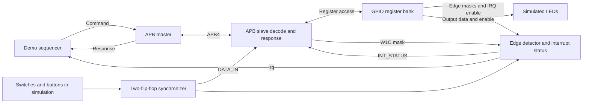
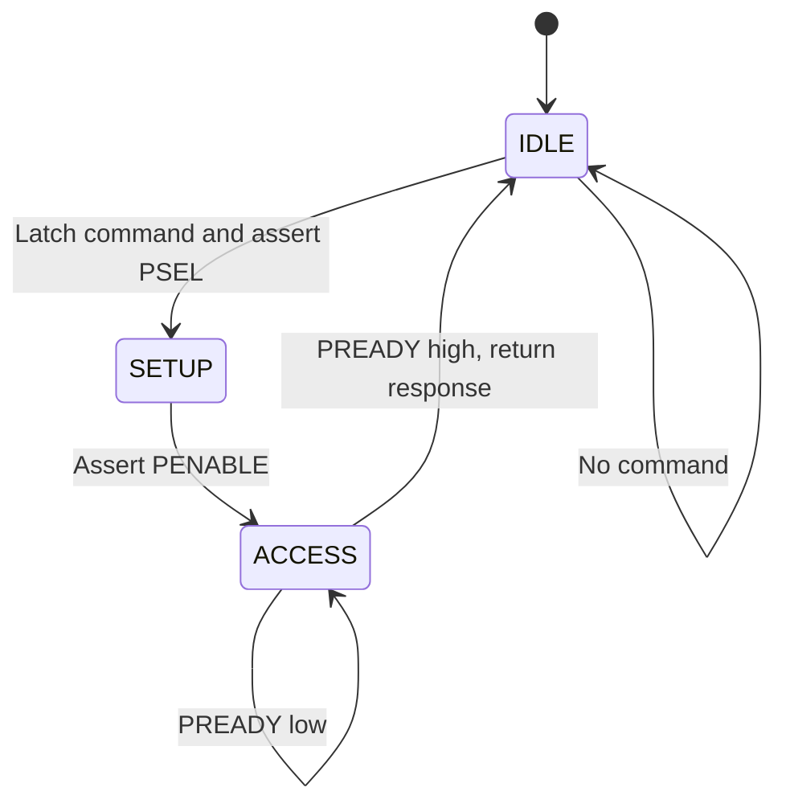
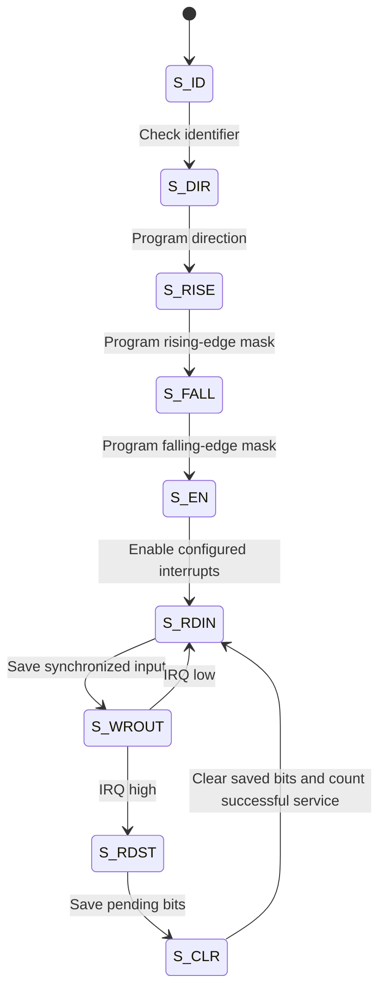

# Design and Verification of an APB4 GPIO Peripheral with Edge-Triggered Interrupts

**Digital System Design Midterm Project · Topic 1 · D5 Technical Report**

| Field | Details |
| --- | --- |
| Course and section | [Insert course code and section] |
| Instructor | [Insert instructor name] |
| Team members | [Insert both names and student IDs] |
| Submission date | [Insert date] |
| RTL revision | [Insert commit ID used for submission] |
| FPGA target | Terasic DE10-Standard, planned |

## Abstract

This project implements a GPIO peripheral with an AMBA APB4 slave interface, a 32-bit register bank, configurable edge interrupts and write-one-to-clear interrupt status. The GPIO width is configurable from 1 to 32 pins. A demonstration sequencer uses an APB master to transfer switch values to LEDs and service pending interrupts. Six simulation stages passed in Icarus Verilog, including directed register tests, a system demonstration and 15 constrained-random runs across five seeds and three wait-state settings. The random scoreboard reported zero mismatches in those 15 runs and detected 14 mismatches when the interrupt clear priority was deliberately reversed. System-level simulation used 16 GPIO pins. SVA execution and FPGA validation are pending.

## 1. Introduction and Requirements

Topic 1 requires a GPIO peripheral with a documented 32-bit register interface. Software reads synchronized GPIO inputs, writes output values, configures per-pin direction and selects which rising or falling edges generate interrupt events. Software reads pending status and clears selected bits with a write-one-to-clear (W1C) operation. The APB slave supports byte strobes and responds with `PSLVERR` to unmapped accesses.

The project includes the peripheral and a simulation of the intended hardware demonstration. The simulated master reads the switch inputs through APB and writes the value back to the output register. It also handles interrupt requests by reading the status register and acknowledging pending events. The full FPGA deliverable is described in Section 6.

| Topic 1 requirement | RTL implementation | Simulation evidence |
| --- | --- | --- |
| Input, output and direction registers | `apb_gpio` and `byte_reg` | Step 4 reset and register checks |
| Two-flip-flop GPIO input synchronization | `sync_2ff` | Steps 1 and 4 |
| Rising, falling and both-edge interrupts | `edge_detect` and `gpio_irq` | Steps 3, 4 and 6 |
| Sticky status with W1C | `gpio_irq` and the slave clear mask | Steps 3–5 |
| Byte-lane writes | `byte_reg` and `PSTRB` | Steps 2, 4 and 5 |
| Error response for illegal accesses | Address decoder in `apb_gpio` | Steps 4 and 5 |
| Switches, LEDs and interrupt service through APB | `gpio_system` | Step 6 system simulation, hardware demo pending |

## 2. APB4 Protocol

APB transfers use a one-cycle SETUP phase followed by one or more ACCESS cycles. At SETUP the master asserts `PSEL` and drives the address and control signals with `PENABLE` low. It asserts `PENABLE` in ACCESS and holds the request stable until the rising clock edge at which `PSEL`, `PENABLE` and `PREADY` are all high. On that edge the master samples the read data or error response. A legal write updates the addressed register at the same completion edge.

| Signal | Width in this design | Role |
| --- | ---: | --- |
| `PCLK`, `PRESETn` | 1 each | APB clock and active-low reset |
| `PSEL`, `PENABLE` | 1 each | Slave selection and ACCESS indication |
| `PADDR` | 12 | Byte address within the peripheral |
| `PWRITE` | 1 | High for write and low for read |
| `PWDATA`, `PRDATA` | 32 each | Write and read data respectively |
| `PSTRB` | 4 | One strobe per write byte, all zero during reads |
| `PPROT` | 3 | Protection attributes accepted at the slave interface |
| `PREADY` | 1 | Slave transfer completion |
| `PSLVERR` | 1 | Error status in the completing ACCESS cycle |

For two wait states, the slave keeps `PREADY` low in the first two ACCESS cycles and asserts it in the third. The table describes the expected sequence while the selected transfer is in progress.

| Phase | `PSEL` | `PENABLE` | `PREADY` | Effect |
| --- | ---: | ---: | ---: | --- |
| SETUP | 1 | 0 | — | Address and request signals are driven. |
| ACCESS, first wait | 1 | 1 | 0 | The master holds the request. |
| ACCESS, second wait | 1 | 1 | 0 | The master continues holding the request. |
| ACCESS, completion | 1 | 1 | 1 | A legal write commits, or read data and error status are sampled. |

*[Figure 1 pending — annotated APB read and write timing from `../sim/step4_ws2.vcd`. Mark clock edges, SETUP, both wait cycles and the completion edge. Label `PADDR`, `PWRITE`, `PWDATA`, `PSTRB`, `PRDATA` and `PSLVERR` where applicable.]*

## 3. Architecture and Register Map

### 3.1 System architecture



The `apb_gpio` slave decodes aligned addresses from `0x00` to `0x1C`. It generates a write enable only for legal writes in the completing ACCESS cycle. Unmapped and unaligned accesses return an error. Writes to the read-only `DATA_IN` and `ID` registers also return an error. Reads of unmapped or unaligned addresses return zero. `PPROT` is present on the interface and does not affect register access.

The bus and register data width is 32 bits. Parameter `N` selects the number of GPIO pins, with a default of 16 and a supported range of 1–32. Unimplemented GPIO bits read as zero. `WAIT_STATES` selects 0–15 additional ACCESS cycles. `ID` supplies the read-only peripheral identifier.

### 3.2 Register map

The table applies to `midterm_project/rtl/apb_gpio.v`, the peripheral used by the tutorial regression. Reset values are hexadecimal. For pin-dependent registers, bit `i` corresponds to GPIO pin `i`.

| Offset | Register | Access | Reset | Bit fields |
| --- | --- | --- | --- | --- |
| `0x00` | `DATA_OUT` | RW | `0x00000000` | `[N-1:0]` output values |
| `0x04` | `DATA_IN` | RO | `0x00000000` | `[N-1:0]` synchronized inputs, updated as pins are sampled after reset |
| `0x08` | `DIR` | RW | `0x00000000` | `[N-1:0]` output enables, 0 for input and 1 for output |
| `0x0C` | `INT_ENABLE` | RW | `0x00000000` | `[N-1:0]` bits eligible to assert `irq` |
| `0x10` | `INT_RISE` | RW | `0x00000000` | `[N-1:0]` rising-edge detection enables |
| `0x14` | `INT_FALL` | RW | `0x00000000` | `[N-1:0]` falling-edge detection enables |
| `0x18` | `INT_STATUS` | RW1C | `0x00000000` | `[N-1:0]` pending events. Writing 1 clears the corresponding bit when its byte lane is enabled. |
| `0x1C` | `ID` | RO | `0x47504901` by default | `[31:0]` read-only peripheral identifier |

Both edge-enable bits can be set for one pin. For a partial write, `PSTRB[i]` enables byte `i` and the other bytes retain their previous values. Writes with all strobes low leave the registers unchanged.

### 3.3 APB master and demo sequencer



The master latches the request in IDLE, drives one SETUP cycle and waits in ACCESS until `PREADY` is high. It then returns the response data and error flag through a one-cycle `rsp_valid` pulse. The sequencer issues one outstanding command. Each transition below follows reception of the response for the current state.



## 4. Design Decisions and Problems Encountered

### 4.1 Asynchronous input sampling

External input transitions can occur at any point in the APB clock cycle. Two flip-flops sample each input before the signal enters the register and interrupt logic. The first stage can become metastable. The second stage gives the first a clock period to settle and reduces the chance that metastability propagates. The edge detector compares the synchronized value with its value on the previous cycle. A pulse shorter than a clock period can be missed if no sampling edge observes it. Mechanical bounce can generate several transitions over successive clock cycles, so debouncing is a separate function. Step 1 exercises both synchronization and a standalone debounce case.

### 4.2 Interrupt state and W1C priority

Pending state and interrupt reporting are separate. Configured edges set sticky status bits, and the interrupt output is the reduction OR of `INT_STATUS & INT_ENABLE`. This allows software to inspect a pending event while its contribution to `irq` is masked. The write data is first gated by the enabled byte lanes to form the W1C mask.

```text
next_status = (current_status AND NOT clear_mask) OR new_events
irq         = OR_REDUCE(current_status AND interrupt_enable)
```

This update preserves a new event when software clears the same bit in the same cycle. Servicing software writes back the bits returned by its status read, which limits the clear request to the events it observed. A sticky bit records that at least one event occurred, so several events on one already-pending pin can coalesce.

### 4.3 Verification bug hunt

An isolated copy of `gpio_irq.v` was changed to apply the clear mask after adding new events. For wait state 0 and seed 1, the scoreboard recorded 14 incorrect reads of `INT_STATUS`. The first mismatch showed `0x00002596` with `0x00002796` expected. The submitted RTL keeps the set-over-clear equation. The corresponding regression with the submitted RTL reported zero mismatches. [Bug-hunt log](../logs/bug_hunt/step5_clear_priority.log) · [Baseline log](../logs/step5_ws0_seed1.log)

## 5. Verification Methodology and Results

### 5.1 Test environment

The regression uses **Icarus Verilog 12.0 (devel)**. APB BFM tasks drive read and write requests, manage the ACCESS wait and sample the response. Directed tests compare responses against known expected values. The random test uses a reference model for register writes, synchronizer stages, edge detection and interrupt status. It checks every completed read and error response and reports coverage for mapped reads and writes, byte strobe combinations, errors, IRQ activity and wait cycles. The additional overlap counter records W1C transactions that coincide with a new event on the same bit.

Reproduce the simulation from the repository root with Icarus Verilog on PATH.

```bash
bash midterm_project/sim/run_all.sh
```

### 5.2 Unit, directed and system results

| Step | Checks | Observed result |
| --- | --- | --- |
| 1 | Reset release, synchronization, edge detection and debounce | PASS. Reset released after two clocks. Detected all 101 rising and 99 falling events. Debounce reduced 21 simulated bounces to two clean changes. |
| 2 | Register reset, byte lanes, masked bits and zero strobe | PASS. The test checked 500 random byte writes in addition to directed cases. |
| 3 | Edge selection, masked pending event, W1C and priority | PASS. The test compared 2,000 random cycles with its model. |
| 4 | Reset, register read/write, illegal accesses and IRQ service | PASS. Both wait-state settings, 0 and 2, completed 51 transfers each with zero errors reported by the checks. |
| 5 | Random APB/GPIO stimulus, scoreboard and coverage | PASS. All 15 seed/wait-state combinations reported zero mismatches and zero coverage holes. |
| 6 | End-to-end APB demo and edge-specific interrupts | PASS. Switch value `0x0A50` appeared on the simulated LEDs. The interrupt count reached 4 across the configured button and pin transitions. |

### 5.3 Constrained-random coverage

Each row represents 4,000 generated APB transfers and a passing test. Error columns count expected APB error responses exercised by the stimulus. Coverage holes and mismatches count test failures or missed coverage requirements.

| Wait states | Seed | Error reads | Error writes | Wait cycles | W1C/event overlaps | Coverage holes | Mismatches |
| ---: | ---: | ---: | ---: | ---: | ---: | ---: | ---: |
| 0 | 1 | 309 | 767 | 0 | 14 | 0 | 0 |
| 0 | 7 | 320 | 745 | 0 | 9 | 0 | 0 |
| 0 | 12 | 311 | 697 | 0 | 20 | 0 | 0 |
| 0 | 42 | 356 | 665 | 0 | 12 | 0 | 0 |
| 0 | 2026 | 326 | 701 | 0 | 12 | 0 | 0 |
| 1 | 1 | 316 | 709 | 4000 | 12 | 0 | 0 |
| 1 | 7 | 346 | 767 | 4000 | 8 | 0 | 0 |
| 1 | 12 | 276 | 674 | 4000 | 13 | 0 | 0 |
| 1 | 42 | 301 | 732 | 4000 | 8 | 0 | 0 |
| 1 | 2026 | 310 | 719 | 4000 | 16 | 0 | 0 |
| 2 | 1 | 307 | 694 | 8000 | 23 | 0 | 0 |
| 2 | 7 | 326 | 690 | 8000 | 14 | 0 | 0 |
| 2 | 12 | 297 | 712 | 8000 | 13 | 0 | 0 |
| 2 | 42 | 301 | 706 | 8000 | 18 | 0 | 0 |
| 2 | 2026 | 318 | 717 | 8000 | 19 | 0 | 0 |

Per-register read/write counts and all 16 byte strobe bins are in the individual simulation logs. [Sample coverage log for two wait states and seed 1](../logs/step5_ws2_seed1.log)

### 5.4 Protocol assertions and scope

The Step 5 testbench can instantiate the SVA checker, which checks SETUP-to-ACCESS sequencing, request stability during waits, read strobes and the valid error window. The additional assertion checks that `PADDR` remains stable between SETUP and ACCESS. **Execution status** is pending on Verilator or Questa. [Pending — add simulator version, normal SVA result and the failing assertion and timestamp from the intentional BFM violation.]

Steps 4–6 used a 16-pin GPIO instance with a 32-bit bus and register interface. [Pending — add a directed `N=32` run that checks the upper byte lanes and exercises interrupts on an upper GPIO pin.]

### 5.5 Waveform evidence

| Figure | Input | Annotation to add |
| --- | --- | --- |
| [Pending] Step 1 | `../sim/step1.vcd` | Mark reset release and the two sampling stages before synchronized input changes. |
| [Pending] Step 2 | `../sim/step2.vcd` | Mark an enabled byte write and the unchanged adjacent byte. |
| [Pending] Step 3 | `../sim/step3.vcd` | Mark a rising event coinciding with W1C and show that the pending bit remains set. |
| [Pending] Step 4 | `../sim/step4_ws2.vcd` | Use Figure 1 to show the request signals held through the two wait cycles. |
| [Pending] Step 5 | `../sim/step5.vcd` | Mark a random legal transfer, an error response and a wait cycle. |
| [Pending] Step 6 | `../sim/step6.vcd` | Mark IRQ assertion, the `INT_STATUS` read and W1C write at `0x18`, and the counter increment. |

## 6. FPGA Implementation and Hardware Results

The planned board is the Terasic DE10-Standard. The intended demonstration uses switches as input, LEDs as output, a push button to trigger an interrupt and an indication that the interrupt was serviced. The final board integration needs to use the same peripheral revision and register map verified in Sections 3–5. The existing Quartus configuration targets a DE10-Standard wrapper with a separate register map. The hardware results below apply to the planned tutorial-aligned build after board integration.

| Item | Result or evidence |
| --- | --- |
| FPGA and toolchain | Terasic DE10-Standard, planned. [Pending — board revision, Quartus version and final RTL revision.] |
| Pin mapping and clock | Existing constraints target `CLOCK_50` at 50 MHz. [Pending — verify switch, key and LED pins, I/O standards and clock constraint for the final wrapper.] |
| Synthesis and fit | [Pending — Quartus compilation report and resource counts for logic, registers and memory blocks.] |
| Timing | [Pending — setup and hold slack at the demo clock, Fmax and timing report excerpt.] |
| Programming | [Pending — final programming file and programming result.] |
| SignalTap | [Pending — annotate one APB transaction with address, data, `PSEL`, `PENABLE` and `PREADY`. Capture interrupt service if available.] |
| Physical demo | [Pending — switch-to-LED observation, button and interrupt behavior, reset check, and photo or video.] |

Planned acceptance checks are to reset the board to a known state, show that switch changes reach the LEDs through APB and observe interrupt behavior on a button press. [Pending — add observed results for each check.]

## 7. Conclusion

The APB4 GPIO peripheral and its demonstration sequencer passed the six-stage simulation regression. Directed tests exercised reset, register access, byte strobes, error responses and interrupt handling. All 15 random configurations passed with zero scoreboard mismatches and zero reported coverage holes. An isolated interrupt-priority fault produced 14 mismatches, showing that the scoreboard can detect loss of a simultaneous event. The remaining evidence covers the 32-pin configuration, the SVA run, FPGA timing and resource use, and operation on the physical board.

## References and Contributions

1. [DSD Midterm Project Topics and deliverable requirements](../../docs/DSD_Midterm_Project.docx).
2. [T1 APB GPIO Student Tutorial and starter files](../../docs/T1_APB_GPIO_Tutorial_Student.docx).
3. Arm, [AMBA APB Protocol Specification, IHI 0024, Issue D](https://developer.arm.com/documentation/ihi0024/d/).

| Contributor | Scope |
| --- | --- |
| [Member 1 name] | [List RTL, testbench, analysis and report contributions.] |
| [Member 2 name] | [List RTL, testbench, analysis and report contributions.] |

The course's Topic 1 student package supplied the starter RTL, testbench and simulation structure. Codex assisted with RTL completion, simulation setup and the report draft. [Complete the disclosure with any other tools or external material used and describe the team's review.]

## Appendix A. Tutorial Discussion Questions

[Pending — answer the end-of-step questions from the Topic 1 tutorial. Cross-reference Sections 2–5 where an answer is already covered. Complete the board-related answers after the hardware demo.]
