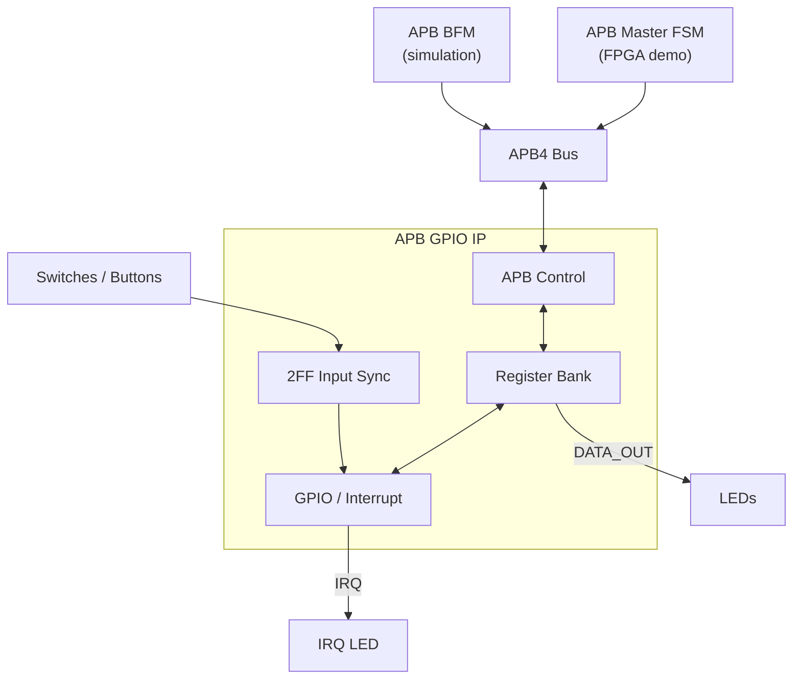
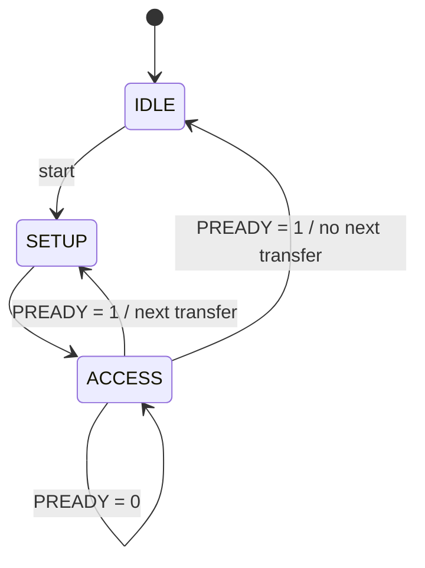

# KẾ HOẠCH CHI TIẾT — TOPIC 1: APB GPIO AND REGISTER BANK WITH INTERRUPTS

> **Môn:** Digital System Design (DSD) — Midterm Project  
> **Nhóm:** 2 sinh viên, mới học Verilog/FSM  
> **Workflow triển khai:** 6 implementation phases + 1 buffer phase, khoảng 8–10 giờ/người/phase  
> **Lịch chi tiết:** Theo `T1_APB_GPIO_Phase_Plan.md`; không làm Stretch trừ khi còn thời gian  
> **FPGA target:** Intel Cyclone V SoC FPGA; Intel Quartus Prime toolchain; `.qsf` pin assignments, `.sdc` timing constraints, and SignalTap debug

## 1. Mục tiêu và phạm vi

Thiết kế một **GPIO controller 32-bit giao tiếp APB4**, bao gồm register bank, điều khiển input/output, phát hiện ngắt theo cạnh trên từng pin, đồng bộ đầu vào 2 flip-flops, kiểm tra bằng testbench tự động và chạy demo trên FPGA.

Project phải có đủ **RTL design, verification và FPGA implementation**, không chỉ dừng ở mô phỏng hoặc bật LED.

### 1.1. Yêu cầu bắt buộc của Topic 1 từ đề

| Hạng mục | Yêu cầu |
|---|---|
| Must have | `DATA_OUT`, `DATA_IN`, `DIRECTION`, `INT_ENABLE`, `INT_STATUS` (write-1-to-clear); rising/falling/both-edge interrupt per pin; 2-flip-flop input synchronizers; `PSLVERR` cho địa chỉ không được map; `PSTRB` byte writes |
| Verify | Đọc/ghi tất cả register, reset values, byte strobes, interrupt set/clear, error response |
| FPGA | Switches/buttons làm input, LEDs làm output, IRQ LED; APB master FSM nhỏ hoặc UART-to-APB debug bridge để ghi/đọc register |
| Stretch (tùy chọn) | Debounce filter có thời gian lập trình được |

### 1.2. Yêu cầu chung áp dụng cho mọi topic

- RTL Verilog-2001 hoặc SystemVerilog synthesizable; không latch, không `initial` trong RTL.
- Clock/reset và tên tín hiệu AMBA đúng chuẩn; reset active-low (`PRESETn`).
- Có parameters phù hợp (data width, address width, clock frequency...).
- Các control FSM phải có state diagram.
- Tuân thủ **APB4**, gồm `PREADY`, `PSLVERR`, `PSTRB`, `PPROT`.
- Có register map: offset, tên, quyền truy cập, reset value, các bit field.
- Unit tests, bus functional model (BFM), self-checking scoreboard/reference model, directed và random tests, protocol assertions, coverage.
- FPGA constraints, timing report, utilization report; không timing violation tại clock demo; SignalTap capture ít nhất một APB transfer.
- Đồng bộ asynchronous inputs và debounce buttons.
- Hai thành viên đều viết RTL/testbench, đều phải giải thích được toàn bộ thiết kế.
- Khai báo code lấy từ các nguồn khác, kể cả AI; không dùng vendor bus IP thay cho block thiết kế chính.

## 2. Nguyên lý hoạt động và kịch bản demo

**Luồng tổng quát:**



**Kịch bản bật LED:**
1. APB master ghi `DIRECTION` để định nghĩa các pin output.
2. APB master ghi `DATA_OUT = 0x0000000F`.
3. Bốn LED tương ứng sáng (giả sử LED active-high và được nối đúng GPIO bits).

**Kịch bản interrupt button:**
1. Đặt GPIO bit 8 ở chế độ input.
2. Cho phép rising-edge detection ở bit 8 và bật `INT_ENABLE[8]`.
3. Button tạo cạnh 0→1 sau khi qua đồng bộ đầu vào.
4. `INT_STATUS[8]` chuyển thành 1; `irq` bật.
5. APB master đọc status và ghi 1 vào bit 8 của `INT_STATUS` để xóa pending interrupt.

## 3. Register map đề xuất

> **Đây là quyết định thiết kế được đề xuất**, không phải địa chỉ/reset value được thầy ấn định. Nhóm cần chốt và ghi rõ trong D1.

| Offset | Register | Access | Reset | Vai trò |
|---|---|---|---|---|
| `0x00` | `DATA_OUT` | RW | `0x00000000` | Output data register |
| `0x04` | `DATA_IN` | RO | Theo input sau đồng bộ | Read synchronized inputs |
| `0x08` | `DIRECTION` | RW | `0x00000000` | 0=input, 1=output |
| `0x0C` | `INT_ENABLE` | RW | `0x00000000` | Mask ngắt từng pin |
| `0x10` | `INT_STATUS` | RO/W1C | `0x00000000` | Pending flags; ghi 1 để clear |
| `0x14` | `INT_RISE_ENABLE` | RW | `0x00000000` | Cho phép rising-edge |
| `0x18` | `INT_FALL_ENABLE` | RW | `0x00000000` | Cho phép falling-edge |

Quy ước:
- `DIRECTION[i]=0`: input, `=1`: output.
- `INT_RISE_ENABLE[i]=1`: phát hiện 0→1; `INT_FALL_ENABLE[i]=1`: phát hiện 1→0.
- Cả hai enable bằng 1: phát hiện cả hai cạnh.
- `INT_STATUS[i]`: pending interrupt; ghi `1` xóa bit đó, ghi `0` không thay đổi.
- `irq = |(INT_STATUS & INT_ENABLE)`.
- Chỉ phát hiện interrupt trên những chân cấu hình input.
- Nếu clear và event xảy ra cùng một chu kỳ: **đề xuất event mới có ưu tiên**; phải viết rõ trong spec và test case.

Công thức edge detection:

```verilog
rise_event =  current_input & ~previous_input;
fall_event = ~current_input &  previous_input;
```

**Lưu ý:** `DATA_IN` là dữ liệu input sau synchronizer, không phải RW register. Giá trị sau reset phụ thuộc dữ liệu tại GPIO pin và độ trễ đồng bộ, không nên mặc định nó luôn bằng 0.

## 4. Thiết kế APB4

| Signal | Ý nghĩa |
|---|---|
| `PCLK` | Clock |
| `PRESETn` | Active-low reset |
| `PADDR` | Register address |
| `PSEL` | Select APB slave |
| `PENABLE` | SETUP/ACCESS phase |
| `PWRITE` | Read/write select |
| `PWDATA` | Write data |
| `PRDATA` | Read data |
| `PSTRB` | Byte write mask |
| `PPROT` | Protection attributes |
| `PREADY` | Ready/transfer completion |
| `PSLVERR` | Transfer error |

### 4.1. Gợi ý thiết kế

- Chọn **zero-wait-state APB slave** để giảm độ phức tạp.
- Chỉ cập nhật writable registers khi transaction write hoàn tất ở ACCESS (`PSEL && PENABLE && PREADY && PWRITE`).
- `PSLVERR` báo lỗi đối với địa chỉ ngoài register map trong ACCESS khi transaction hoàn tất.
- `PSTRB` chỉ cập nhật byte có bit strobe tương ứng bằng 1; với `INT_STATUS`, W1C cũng tuân thủ byte strobes.
- Quy định rõ cách xử lý write vào register read-only và `PPROT` trong specification.

### 4.2. FSM cho APB master demo



- `IDLE`: `PSEL=0`.
- `SETUP`: `PSEL=1`, `PENABLE=0`; ổn định address/control/write data.
- `ACCESS`: `PSEL=1`, `PENABLE=1`; đợi `PREADY=1` và hoàn tất transfer. Trong lúc wait phải giữ ổn định các tín hiệu theo APB.
- Back-to-back có thể chuyển từ ACCESS sang SETUP của giao dịch tiếp theo mà không cần IDLE.
- Phase 1 phải **vẽ tay timing diagram read và write** theo đề.

## 5. Kiến trúc file và module

```text
T1_APB_GPIO/
├── rtl/
│   ├── apb_gpio_top.v
│   ├── apb_slave_ctrl.v
│   ├── gpio_registers.v
│   ├── gpio_input_sync.v
│   ├── gpio_interrupt.v
│   ├── apb_master_demo.v
│   └── fpga_top.v
├── tb/
│   ├── tb_apb_gpio.sv
│   ├── tb_input_sync.sv
│   ├── tb_gpio_interrupt.sv
│   ├── apb_bfm.sv
│   ├── gpio_scoreboard.sv
│   └── apb_assertions.sv
├── constraints/
├── reports/
├── docs/
└── README.md
```

| Module | Nhiệm vụ |
|---|---|
| `apb_gpio_top.v` | Tích hợp toàn bộ IP |
| `apb_slave_ctrl.v` | Decode APB, điều khiển read/write, PREADY/PSLVERR |
| `gpio_registers.v` | DATA_OUT, DIRECTION, INT_ENABLE, cấu hình edge |
| `gpio_input_sync.v` | Input synchronizer 2 FF |
| `gpio_interrupt.v` | Edge detection, INT_STATUS W1C, IRQ |
| `apb_master_demo.v` | Tạo APB transactions trên FPGA để demo |
| `fpga_top.v` | Nối IP với clock/reset, switches/buttons/LEDs |

**Thứ tự code:** input synchronizer → register bank → APB slave control → interrupt logic → GPIO top → demo master → FPGA top.

## 6. Phân chia theo hạng mục chức năng

### APB và Register Bank
- APB4 signals, interface, slave control.
- Register bank, address decode, PSTRB, PSLVERR.
- APB BFM và register tests.
- Phần protocol/FSM/register map của báo cáo.

### GPIO và Interrupt
- Input synchronizer, GPIO direction/output.
- Rising/falling/both-edge logic, W1C status và IRQ.
- Interrupt unit tests, hỗ trợ FPGA top/demo.
- Phần GPIO architecture/FPGA implementation của báo cáo.

### Integration và Verification
- Chốt interfaces/register map trước khi code.
- Viết RTL và testbench theo ranh giới module đã chốt.
- Tích hợp, debug, random tests, assertions, coverage.
- FPGA synthesis, timing/SignalTap, tài liệu, slide và Q&A.

**Quản lý code đề xuất:** Dùng Git repository; tổ chức nhánh theo feature/module và review trước khi merge sau khi unit tests PASS.

## 7. Verification checklist

### 7.1. Register/APB
- [x] Reset defaults cho mọi writable register.
- [x] Read/write từng register (bao gồm RO/W1C behavior).
- [x] `PSTRB` thử toàn bộ 16 tổ hợp.
- [x] Invalid address → `PSLVERR` đúng pha và giao dịch.
- [x] APB SETUP/ACCESS đúng trình tự; back-to-back transfers.
- [x] Address/control/write data giữ ổn định khi cần theo APB protocol.

### 7.2. GPIO/Interrupt
- [x] GPIO output phản ánh `DATA_OUT` và `DIRECTION`.
- [x] `DATA_IN` đọc synchronized inputs, kiểm tra độ trễ 2FF.
- [x] Rising-edge detection.
- [x] Falling-edge detection.
- [x] Both-edge detection.
- [x] No interrupt ở pin output (theo quy ước thiết kế).
- [x] `INT_ENABLE` mask IRQ chính xác.
- [x] W1C: write 1 clear, write 0 giữ nguyên.
- [x] Clear và event cùng chu kỳ có kết quả đúng chính sách.
- [x] Reset xóa pending IRQ.

### 7.3. Random, assertions và coverage
- [x] Random APB reads/writes/addresses/PSTRB.
- [x] Random GPIO transitions và interrupt configuration.
- [x] Scoreboard/reference model tự so sánh tất cả kết quả quan trọng.
- [x] Procedural assertions về APB phase và stability, tương thích Icarus.
- [x] Assertions/checks về IRQ/status.
- [x] Coverage table cho tất cả registers, edge modes, PSTRB/error cases.
- [x] Test logs có PASS/FAIL summary rõ ràng.

## 8. Kịch bản demo FPGA

1. **Reset:** register reset đúng và IRQ tắt.
2. **Output:** APB master ghi `DIRECTION`, rồi thay đổi `DATA_OUT` để bật LED theo pattern.
3. **Input:** thay switches, APB master đọc `DATA_IN`, hiển thị kết quả ra LED/7-segment nếu có.
4. **Interrupt:** cấu hình rising-edge interrupt, nhấn button → IRQ LED sáng, ghi W1C → IRQ LED tắt.
5. **Debug capture:** SignalTap capture APB read hoặc write với `PSEL`, `PENABLE`, `PADDR`, `PWRITE`, `PREADY`, data và response.

Các công việc đi kèm:
- [x] Chọn Intel Cyclone V SoC FPGA và Intel Quartus Prime.
- [x] Xác nhận board DE10-Standard, device `5CSXFC6D6F31C6N`, clock 50 MHz và pinout từ user manual.
- [ ] Xác nhận board revision, Quartus version tương thích và quy trình JTAG trên máy dùng để demo.
- [x] Tạo `fpga_top.v` và `apb_master_demo.v`; simulation Phase 5A PASS.
- [x] Tạo DE10-Standard board wrapper, `.qsf` pin assignments và `.sdc` clock/timing constraints cho demo; offline simulation PASS.
- [x] Synchronizer cho asynchronous inputs; debounce buttons (có thể cố định ở FPGA top).
- [ ] Synthesis và implementation không timing violation tại clock demo.
- [ ] Export utilization (LUT, FF, BRAM) và timing (WNS, max clock frequency).
- [ ] Lưu `.sof` programming file và SignalTap capture.

> IP phải hỗ trợ **32-bit GPIO**, dù board chỉ có ít LED/switch; chỉ cần map một phần 32-bit tới I/O vật lý trong demo.

## 9. Deliverables và chấm điểm

| Mã | Nộp gì | Định lượng theo đề |
|---|---|---|
| D1 | Design specification/proposal: topic, block diagram, signals, register map, FSM, test plan, demo plan | 3–5 trang |
| D2 | RTL sources, documented parameters, README/file hierarchy | Tất cả source |
| D3 | Testbenches, BFM, assertions, PASS/FAIL logs, coverage, key waveforms | Verification package |
| D4 | Quartus project, `.qsf`/`.sdc`, `.sof`, utilization/timing reports, SignalTap capture | FPGA package |
| D5 | Protocol, architecture, decisions, verification/FPGA results, issues and fixes | 12–20 trang |
| D6 | Presentation và live demo | 15–20 slides, 15 phút trình bày/demo + 5 phút Q&A |

**Thang điểm:** Specification/protocol 15; RTL 25; Verification 25; FPGA 15; Technical report 10; Presentation/Q&A 10 (tổng 100). Stretch được tính vào chất lượng RTL/verification. Individual marks có thể điều chỉnh qua hỏi đáp và peer evaluation.

## 10. Rủi ro và cách giảm thiểu

| Rủi ro | Giải pháp |
|---|---|
| Sai APB timing | Vẽ timing trước, APB BFM và assertions từ sớm |
| Ghi byte sai `PSTRB` | Directed test tất cả strobe masks, đặc biệt W1C |
| IRQ sai hoặc mất event | Unit test interrupt riêng; định nghĩa priority set/clear |
| Button bounce | Debounce ở FPGA top; không nhầm với programmable debounce Stretch |
| Sim chạy nhưng FPGA lỗi | Xác nhận Cyclone V device/board và Quartus setup trong Phase 1; hoàn thành synthesis và board integration trong Phase 5 |
| Thiếu verification | Test matrix, scoreboard, assertions, coverage rõ ràng |
| Không kịp report | Viết tài liệu theo từng module ngay trong quá trình thiết kế |
| Board thiếu I/O | Giữ IP 32-bit, map các bits cần demo; chốt demo theo board thực tế |

## 11. Checklist nghiệm thu cuối cùng

- [ ] T1 được thầy duyệt; không trùng nhóm khác.
- [x] APB4 slave đúng protocol, đủ `PPROT/PSTRB/PREADY/PSLVERR`.
- [x] Đủ 5 registers bắt buộc và cấu hình edge trên từng pin.
- [x] Input 2FF synchronizers; IRQ rising/falling/both; W1C.
- [ ] RTL synthesizable, không latch/`initial` trong RTL.
- [x] Unit tests, directed/random, BFM, scoreboard, assertions, coverage đều có minh chứng.
- [ ] FPGA demo: switches/buttons → DATA_IN, DATA_OUT → LEDs, IRQ LED.
- [ ] Có APB master demo FSM hoặc UART-to-APB bridge.
- [ ] Quartus `.qsf`/`.sdc`, `.sof`, timing/utilization reports và SignalTap capture đầy đủ.
- [ ] D1–D6 đúng định dạng, số trang/slides và thời gian presentation.
- [ ] Mỗi thành viên đều nắm APB, register map, RTL, verification và demo.
- [ ] Đã khai báo nguồn code/AI/vendor IP nếu có.

## 12. Việc phải làm trong Phase 1

1. Đọc chính phần APB4 trong spec: SETUP, ACCESS, read/write timing, PREADY, PSLVERR, PSTRB.
2. Chốt register map 7 thanh ghi và interrupt clear/set priority.
3. Vẽ block diagram; thống nhất port giữa APB controller, registers và interrupt logic.
4. Xác nhận board revision, Quartus version tương thích và quy trình JTAG để tránh trễ demo; device và pinout đã được chốt từ DE10-Standard user manual.

**Thứ tự ưu tiên:** APB4 slave → register bank → input synchronizer → interrupt → self-checking tests → FPGA demo → reports/SignalTap → Stretch (nếu còn thời gian).

## 13. Tài liệu tham khảo

- Đề bài: `DSD_Midterm_Project.md`, phần T1, Common technical requirements, Deliverables/Schedule/Assessment.
- [Arm AMBA APB Protocol Specification — ARM IHI 0024D](https://documentation-service.arm.com/static/60d5b505677cf7536a55c245).

---

*Các địa chỉ register, quy tắc interrupt set/clear, kiến trúc module và hạng mục theo phase là **đề xuất triển khai**, cần nhóm thống nhất và ghi vào proposal; những yêu cầu bắt buộc được phân biệt trong phần 1.*
